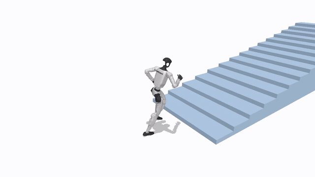
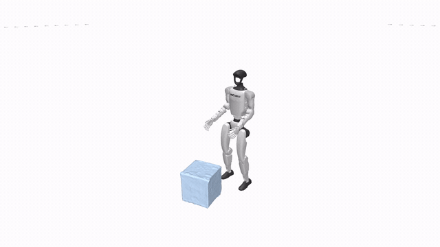
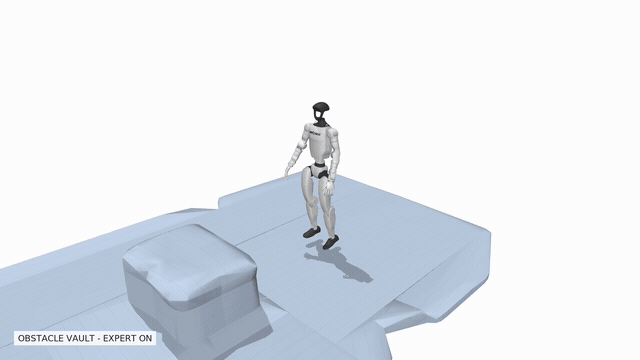
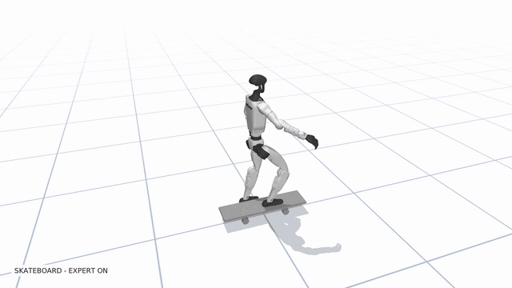
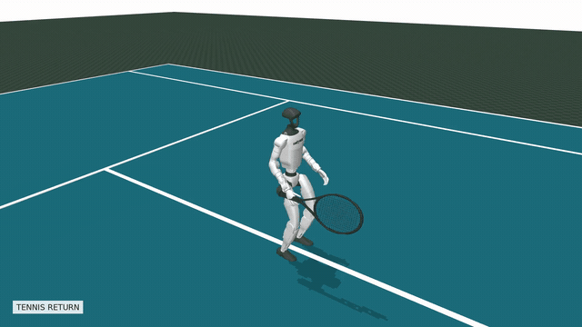
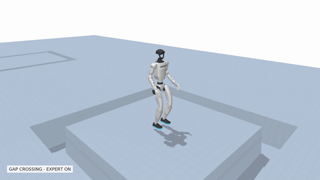

<div align="center">

# PERA

**Incremental Skill Learning for Humanoid Robots**

[Project Page](https://shangchaohu718.github.io/pera-project/) · [Paper](https://arxiv.org/abs/2611.16188) · [English](README.md) · [简体中文](README.zh-CN.md)

</div>

PERA expands a pretrained humanoid controller with independently trained task experts. The HoloMotion-G1 version freezes the public Actor and learns an additional FFN and routing score for each task, using task rewards or teacher-action supervision.

- **Reuse the base:** preserve the pretrained observation encoder, attention, public experts and action head.
- **Train a task module:** update the added FFN/router with PPO or DAgger, depending on the task.
- **Switch on demand:** install multiple task modules in one Actor and enable at most one per robot. Disabling task experts restores the public computation path.

## Skills in action

<table>
<tr>
<td align="center" width="33%"><b>Stair ascent</b><br/><a href="assets/readme/stairs.mp4"></a></td>
<td align="center" width="33%"><b>Box carrying</b><br/><a href="assets/readme/box-carrying.mp4"></a></td>
<td align="center" width="33%"><b>Obstacle vault</b><br/><a href="assets/readme/vault.mp4"></a></td>
</tr>
<tr>
<td align="center" width="33%"><b>Skateboarding</b><br/><a href="assets/readme/skateboard.mp4"></a></td>
<td align="center" width="33%"><b>Tennis returns</b><br/><a href="assets/readme/tennis.mp4"></a></td>
<td align="center" width="33%"><b>Gap crossing</b><br/><a href="assets/readme/gap-crossing.mp4"></a></td>
</tr>
</table>

<sub>Individual HoloMotion-base student recordings from the project page. Original playback speed; GIFs loop for preview. Click a scene for its video. Selected rollouts illustrate behavior and are separate from batch success-rate evaluation.</sub>

## How it works

1. Start from the same frozen HoloMotion G1 v1.4 `model_14000` Actor for each task.
2. Add a task FFN and router inside the Actor. Train the new parameters while the public network participates in the forward pass.
3. Load the task modules alongside the shared base and select the appropriate expert for the task. Preserve each task's observation, context-encoder and action conventions.

The HoloMotion models shown here retain their trained anchor-group mixture and native public Top-2 routing. Expert switching is explicit. This gallery does not demonstrate automatic task selection or uninterrupted transitions between scenes.

## Paper and project resources

- [Read the paper](https://arxiv.org/abs/2611.16188)
- [Explore the project page](https://shangchaohu718.github.io/pera-project/)
- [Browse the skill catalog and recorded comparisons](website/public/data/expert-catalog.json)
- [View the available experimental evidence](website/public/data/evidence.json)

This repository currently contains the editable project website, demonstration media and supporting evidence. Training/evaluation code and task-plugin distribution are being prepared separately; a complete training reproduction package is not yet available here. The paper covers multiple base-policy experiments; the six recordings above are the HoloMotion version.

## HoloMotion base

Official pretrained weights are **not redistributed** in this repository. Obtain the `HoloMotion_motion_tracking_model_v1.4.0` package directly from [HorizonRobotics/HoloMotion_models](https://huggingface.co/HorizonRobotics/HoloMotion_models/tree/e3c90dd1f7483d02d3b4d2e5fb3a359c6ff9c67a/HoloMotion_motion_tracking_model_v1.4.0).

The current adapter requires the matching `config.yaml`, `model_14000/actor/model.safetensors` and `model_14000/critic/model.safetensors`. The model card labels the weights CC BY-NC-SA 4.0; HoloMotion source code has its own Apache-2.0 license. Task plugins, frozen encoders, datasets and robot assets retain their applicable upstream terms.

<details>
<summary><b>Edit and run the project website locally</b></summary>

Requires Node.js 22 and npm.

```bash
git clone https://github.com/shangchaohu718/pera-project.git
cd pera-project/website
npm ci
npm run dev
```

Build the static site:

```bash
PAGES_BASE_PATH=/pera-project/ npm run build
npm run preview
```

Page content and styles are under `website/src/`; public assets are under `website/public/`. See [website development notes](website/README.md) for details. These commands run the website, not robot training or simulation.

</details>

## Citation

If you use PERA in your research, please cite:

```bibtex
@misc{hu2026pera,
  title={PERA: Plug-in Experts for Robotic Actions in Continual Whole-Body Control},
  author={Shangchao Hu and Yadan Sun and Xibo Yu and Wei Huang},
  year={2026},
  eprint={2611.16188},
  archivePrefix={arXiv},
  primaryClass={cs.RO},
  url={https://arxiv.org/abs/2611.16188}
}
```

<div align="center">


**Thanks for exploring PERA. A ⭐ or a new idea both help this project grow.**

</div>

## Acknowledgements

We thank the authors and maintainers of the following open-source projects for their code, pretrained policies, motion resources and research contributions:

- [FlexOlmo](https://github.com/allenai/FlexOlmo)
- [HoloMotion](https://github.com/HorizonRobotics/HoloMotion), [BeyondMimic](https://github.com/HybridRobotics/whole_body_tracking)
- [BlinkMimic](https://github.com/fuyichen0725/blinkmimic), [supermimic_vibed](https://github.com/zita-ch/supermimic_vibed) and [InstantTrack](https://github.com/Huy-Quang-Dao/instantTrack)
- [InstinctLab](https://github.com/project-instinct/InstinctLab), [InstinctMJ](https://github.com/project-instinct/InstinctMJ) and [instinct_rl](https://github.com/project-instinct/instinct_rl)
- [MimicX](https://github.com/NEBULIS-Lab/MimicX) and [PMT](https://github.com/Mondo-Robotics/PMT)
- [HUSKY](https://github.com/TeleHuman/humanoid_skateboarding), [ATHLETE](https://github.com/HazinTihoa/athlete-humanoid-tennis) and [ULTRA](https://github.com/Sirui-Xu/ULTRA)
- [PBHC](https://github.com/TeleHuman/PBHC) and [KungfuBot](https://github.com/thaixuankhanh/kungfubot)
- [unitree_rl_mjlab](https://github.com/unitreerobotics/unitree_rl_mjlab) and [unitree_ros](https://github.com/unitreerobotics/unitree_ros)
- [mjlab](https://github.com/mujocolab/mjlab), [MuJoCo](https://github.com/google-deepmind/mujoco), [MuJoCo-Warp](https://github.com/google-deepmind/mujoco_warp), [NVIDIA Warp](https://github.com/NVIDIA/warp) and [Isaac Lab](https://github.com/isaac-sim/IsaacLab)
- [PyTorch](https://github.com/pytorch/pytorch) and [pytorch_kinematics](https://github.com/UM-ARM-Lab/pytorch_kinematics)
