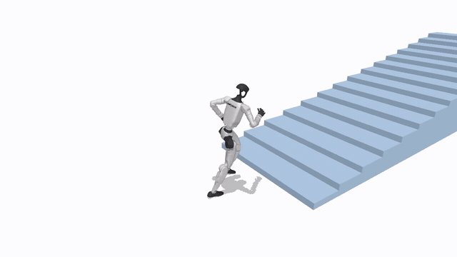
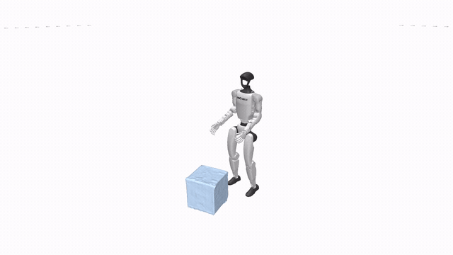
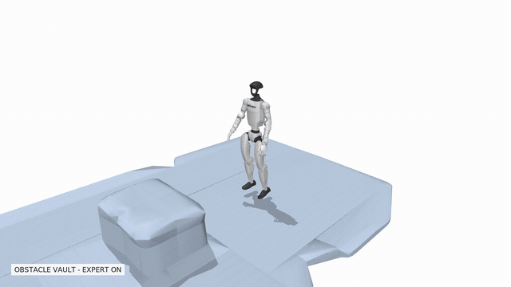
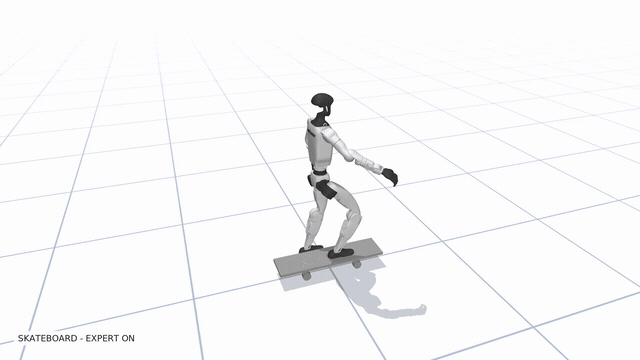
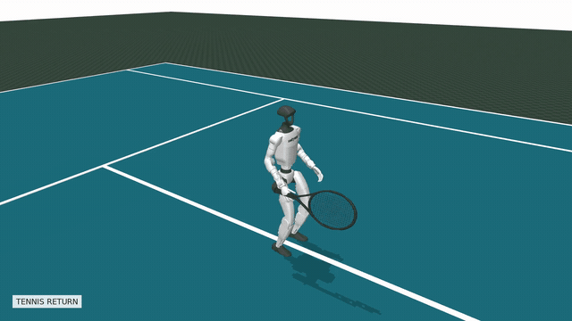
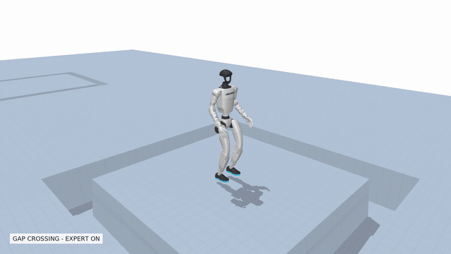

<div align="center">

# PERA

**人形机器人的增量技能学习**

[Project Page](https://shangchaohu718.github.io/pera-project/) · [Paper](https://arxiv.org/abs/2611.16188) · [English](README.md) · [简体中文](README.zh-CN.md)

</div>

PERA 通过独立训练任务专家，为已有的人形机器人控制器扩展新技能。HoloMotion-G1 版本冻结公共 Actor，通过任务奖励或教师动作监督，学习每个任务新增的 FFN 和路由分数。

- **复用公共底座：**保留预训练观测编码、Attention、公共专家与动作输出头。
- **独立训练专家：**按任务采用 PPO 或 DAgger，只更新新增 FFN/router。
- **按需切换技能：**同一个 Actor 安装多个任务模块，每个机器人最多开启一个；关闭新增专家后恢复公共计算路径。

## 技能展示

<table>
<tr>
<td align="center" width="33%"><b>上楼梯</b><br/><a href="assets/readme/stairs.mp4"></a></td>
<td align="center" width="33%"><b>搬箱子</b><br/><a href="assets/readme/box-carrying.mp4"></a></td>
<td align="center" width="33%"><b>翻越障碍</b><br/><a href="assets/readme/vault.mp4"></a></td>
</tr>
<tr>
<td align="center" width="33%"><b>滑板</b><br/><a href="assets/readme/skateboard.mp4"></a></td>
<td align="center" width="33%"><b>网球回击</b><br/><a href="assets/readme/tennis.mp4"></a></td>
<td align="center" width="33%"><b>跨沟</b><br/><a href="assets/readme/gap-crossing.mp4"></a></td>
</tr>
</table>

<sub>以上均为项目主页的 HoloMotion 底座学生单场景录像，保持原速；GIF 循环预览，点击场景查看视频。选定录像用于展示行为，与批量成功率评测分开。</sub>

## 方法概览

1. 每个任务都从同一份冻结的 HoloMotion 官方 G1 v1.4 `model_14000` Actor 出发。
2. 在 Actor 内添加任务 FFN 和 router。公共网络共同参与前向计算，只更新新增参数。
3. 将独立训练的任务模块加载到共享底座，按任务选择对应专家，并保持原有的观测、上下文编码器和动作接口。

这里展示的 HoloMotion 权重保持训练时的锚定分组混合，公共组内部沿用原生 Top-2。专家通过显式开关选择；这些单场景录像不代表自动识别任务或场景之间全程连续衔接。

## 论文与项目资源

- [阅读论文](https://arxiv.org/abs/2611.16188)
- [访问项目主页](https://shangchaohu718.github.io/pera-project/)
- [技能目录与已录制对照](website/public/data/expert-catalog.json)
- [现有实验记录](website/public/data/evidence.json)

本仓库目前提供可编辑的项目网站、演示素材和相关实验记录。训练/评估代码与任务插件的分发正在单独整理，本仓库尚未包含完整训练复现包。论文涵盖多种底座实验，上述六段录像展示的是 HoloMotion 版本。

## HoloMotion 基座

本仓库**不附带或镜像分发官方预训练权重**。请直接从 [HorizonRobotics 官方模型库](https://huggingface.co/HorizonRobotics/HoloMotion_models/tree/e3c90dd1f7483d02d3b4d2e5fb3a359c6ff9c67a/HoloMotion_motion_tracking_model_v1.4.0) 获取 `HoloMotion_motion_tracking_model_v1.4.0`。

当前适配器需要匹配的 `config.yaml`、`model_14000/actor/model.safetensors` 和 `model_14000/critic/model.safetensors`。官方模型页标注的权重许可为 CC BY-NC-SA 4.0，HoloMotion 源码采用其 Apache-2.0 许可。任务插件、冻结编码器、数据集和机器人资产保留各自适用条款。

<details>
<summary><b>本地编辑与运行项目网站</b></summary>

需要 Node.js 22 和 npm。

```bash
git clone https://github.com/shangchaohu718/pera-project.git
cd pera-project/website
npm ci
npm run dev
```

构建静态网站：

```bash
PAGES_BASE_PATH=/pera-project/ npm run build
npm run preview
```

页面内容与样式位于 `website/src/`，公开素材位于 `website/public/`。详细说明见[网站开发文档](website/README.md)。这些命令运行的是项目网站，不会启动机器人训练或仿真。

</details>

## 引用

如果你的研究使用了 PERA，请引用：

```bibtex
@misc{hu2026pera,
  title={PERA: Plug-in Experts for Robotic Actions in Continual Whole-Body Control},
  author={Shangchao Hu and Yadan Sun and Xibo Yu and Wei Huang},
  year={2026},
  eprint={2611.16188},
  archivePrefix={arXiv},
  primaryClass={cs.RO},
  url={https://arxiv.org/abs/2611.16188}
}
```

<div align="center">


**谢谢你来看看 PERA。留颗 ⭐，或聊聊你的新想法，都是对项目的支持。**

</div>

## 致谢

感谢以下开源项目的作者与维护者，感谢他们提供的代码、预训练策略、动作资源与研究成果：

- [FlexOlmo](https://github.com/allenai/FlexOlmo)
- [HoloMotion](https://github.com/HorizonRobotics/HoloMotion) 和 [BeyondMimic](https://github.com/HybridRobotics/whole_body_tracking)
- [BlinkMimic](https://github.com/fuyichen0725/blinkmimic)、[supermimic_vibed](https://github.com/zita-ch/supermimic_vibed) 和 [InstantTrack](https://github.com/Huy-Quang-Dao/instantTrack)
- [InstinctLab](https://github.com/project-instinct/InstinctLab)、[InstinctMJ](https://github.com/project-instinct/InstinctMJ) 和 [instinct_rl](https://github.com/project-instinct/instinct_rl)
- [MimicX](https://github.com/NEBULIS-Lab/MimicX) 和 [PMT](https://github.com/Mondo-Robotics/PMT)
- [HUSKY](https://github.com/TeleHuman/humanoid_skateboarding)、[ATHLETE](https://github.com/HazinTihoa/athlete-humanoid-tennis) 和 [ULTRA](https://github.com/Sirui-Xu/ULTRA)
- [PBHC](https://github.com/TeleHuman/PBHC) 和 [KungfuBot](https://github.com/thaixuankhanh/kungfubot)
- [unitree_rl_mjlab](https://github.com/unitreerobotics/unitree_rl_mjlab) 和 [unitree_ros](https://github.com/unitreerobotics/unitree_ros)
- [mjlab](https://github.com/mujocolab/mjlab)、[MuJoCo](https://github.com/google-deepmind/mujoco)、[MuJoCo-Warp](https://github.com/google-deepmind/mujoco_warp)、[NVIDIA Warp](https://github.com/NVIDIA/warp) 和 [Isaac Lab](https://github.com/isaac-sim/IsaacLab)
- [PyTorch](https://github.com/pytorch/pytorch) 和 [pytorch_kinematics](https://github.com/UM-ARM-Lab/pytorch_kinematics)
